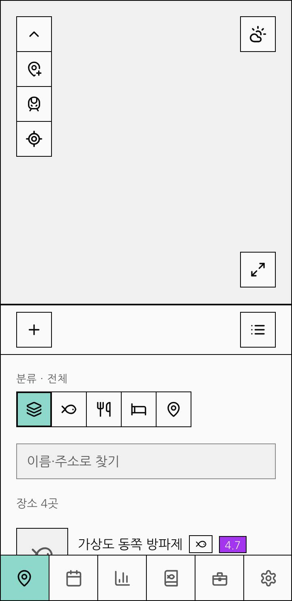
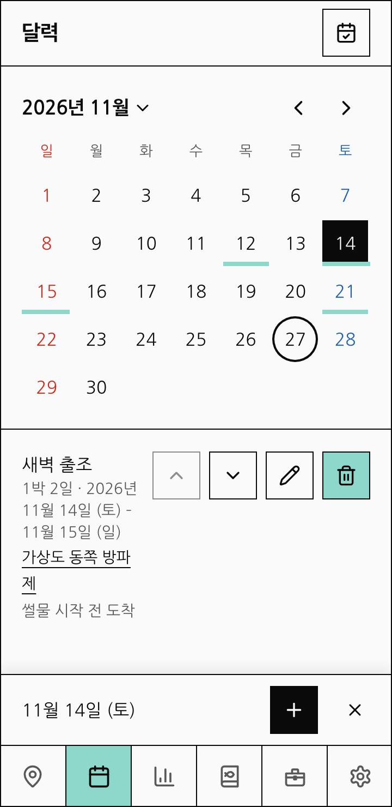
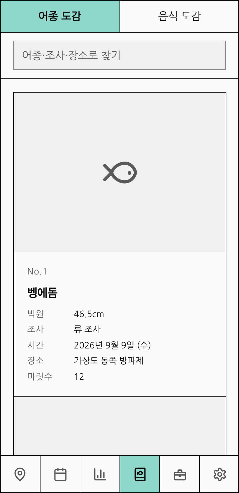
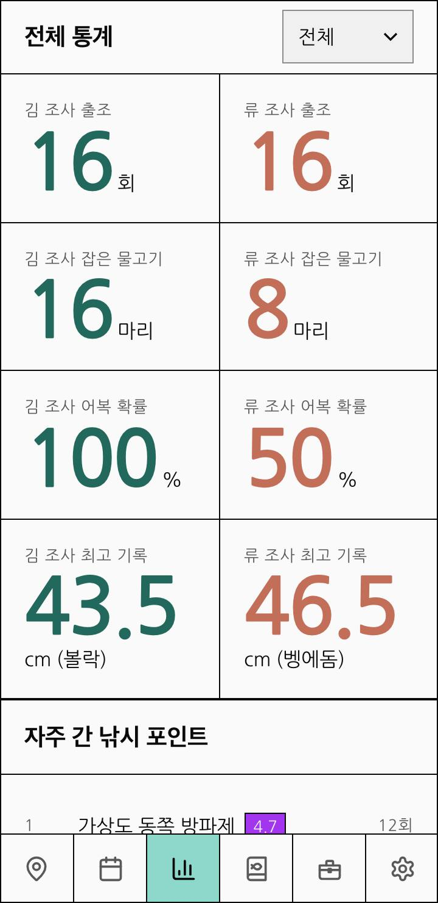

# 낚고먹고 (NGMG-web)
두 사람이 함께 쓰는 낚시·맛집 지도와 출조 일정·기록 서비스입니다. 배포 주소: [https://ngmg.kr](https://ngmg.kr)

## 주요 화면
로그인이 필요한 앱이라 서버 없이 가짜 데이터로 띄운 데모 화면입니다(장소와 기록은 모두 가상 데이터).

<p>
  
  
  
  
</p>

## 주요 기능
- **지도와 장소:** Kakao 지도에 낚시·맛집·숙박·기타 장소를 저장하고, 평점에 따라 핀 색이 바뀝니다. 고른 장소의 날씨와 기온은 Open-Meteo에서 받습니다.
- **일정:** 달력에서 날짜를 눌러 장소가 붙은 출조 일정을 만들고, 그날 챙길 물품을 체크리스트로 확인합니다.
- **기록:** 잡은 물고기와 먹은 음식을 사진(칸마다 5장까지)과 함께 남기고, 조사마다 0.5점 단위로 평점을 줍니다. 오프라인에서 저장하면 연결될 때 올립니다.
- **도감·통계:** 어종·음식 도감과 조사별 출조 횟수, 잡은 물고기, 어복 확률, 최고 기록을 연도별 또는 전체로 봅니다.
- **물품:** 낚시 장비를 조사별로 등록하고 일정에 연결합니다.
- **알림과 설치:** 출조 전날 웹 푸시 알림을 받고, 홈 화면에 앱으로 설치할 수 있습니다.
- **읽기 전용 계정:** `guest` 계정은 모든 데이터를 보기만 하고 쓰지 못합니다.

## 기술 스택


## 실행 방법
```bash
# 레포지토리 클론
git clone https://github.com/deokbae-cinephile/NGMG-web.git
cd NGMG-web

# 패키지 설치(Node 24 이상, pnpm 12)
pnpm install

# 환경 변수 파일 만들기(.env.example을 복사해 Supabase·Kakao 키를 채웁니다)
cp .env.example .env.local

# 개발 서버 실행(http://localhost:5173)
pnpm dev

# 서버와 키 없이 가짜 데이터로 둘러보기
pnpm run demo
```

환경 변수, 서버 준비, 배포 등 자세한 내용은 [개발 가이드](documents/development.md), 작업 규칙은 [AGENTS.md](AGENTS.md), 외부 자료의 출처는 [CREDITS.md](CREDITS.md)에 있습니다.
