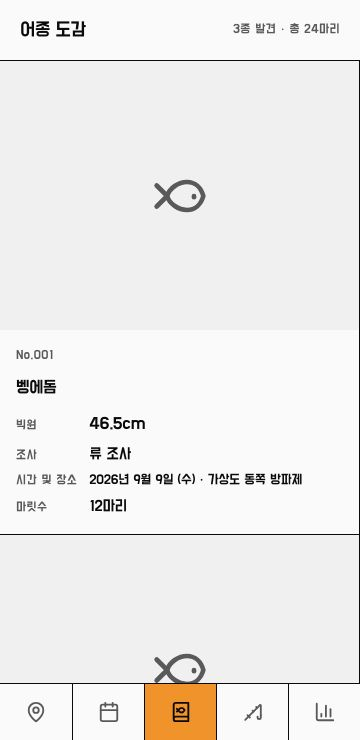
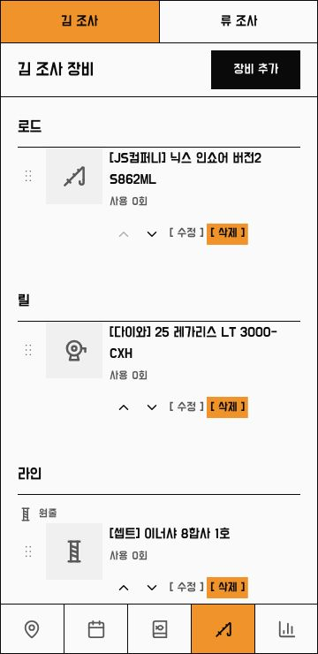
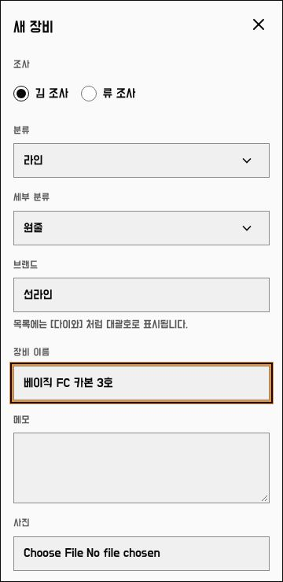

# NGMG Web - 낚고먹고

[](https://github.com/deokbae-cinephile/NGMG-web/actions/workflows/ci.yml)


낚시 포인트와 맛집을 지도에 남기고, 출조 일정과 조과 기록, 장비와 어종 도감을 함께 챙기는 2인용 반응형 웹 서비스입니다.

> **프로젝트 상태:** 두 사람이 직접 쓰는 서비스로, Supabase와 Kakao 지도를 연결해 [ngmg.kr](https://ngmg.kr)에 배포했습니다. 공용 계정으로만 로그인할 수 있으며, 서버 없이 둘러보려면 `pnpm run demo`를 실행합니다.

## 화면

화면의 장소, 일정, 기록은 모두 가상 데이터입니다. 스크린샷은 가짜 서버로 찍어 지도 자리에 실제 지도 대신 가짜 배경이 보입니다.

| 지도                                                                                                     | 일정                                                                                                                       |
| -------------------------------------------------------------------------------------------------------- | -------------------------------------------------------------------------------------------------------------------------- |
|  |  |

| 휴대폰 일정                                                                                     | 어종 도감                                                                     |
| ------------------------------------------------------------------------------------------------- | ----------------------------------------------------------------------------- |
|  |  |
| **통계**                                                                                     | **로그인**                                                                    |
|  |  |
| **장비**                                                                                     | **장비 추가**                                                                 |
|  |  |

## 주요 기능

| 기능     | 내용                                                                       |
| -------- | -------------------------------------------------------------------------- |
| 지도     | 길찾기 출발지 토글(무악재역), 마지막 위치 기억, 낚시·맛집·기타 아이콘 핀, 평균 별점별 핀 색, 분류별 색의 핀 묶음, 핀 정보 말풍선, 위성 지도, 분류·태그 필터, 이름·주소·태그 검색, 이름·태그·거리·최근순 정렬 |
| 장소     | 주소·이름 검색으로 추가, 태그, 대표 사진, 메모, 길찾기, 주소 복사, 공유, 기록 요약 |
| 일정 및 기록 | 달력·고른 날·전체 기록을 한 화면에서 확인, 연박 일정, 공휴일·주말 색, D-day, 지난 일정에서 기록 남기기, 조사별 잡은 물고기, 날씨 상태, 어종 검색, 사진 10장, 물때·날씨 |
| 물때·날씨 | 일정 장소 기준 물때와 음력, 15일 예보(날씨, 기온, 강수, 바람, 파고)              |
| 통계     | 연도별 출조 횟수, 맛집 방문, 낚시·맛집 평균 별점, 월별 출조, 자주 간 장소·미끼, 조사별 마릿수와 최대어 |
| 장비     | 조사별·분류별(로드, 릴, 라인(원줄·목줄), 채비, 미끼, 기타) 장비 목록, 끌어서 정렬, 브랜드, 사진, 사용 횟수 |
| 어종 도감 | 잡은 어종을 번호와 함께 모으고 빅원 길이, 잡은 조사, 마릿수 표시 |
| 함께 쓰기 | 공용 계정 하나로 두 사람이 모든 데이터를 함께 보고 수정, 데이터 백업, 앱 설치(PWA, 바로가기·설치 미리보기) |

## 기술 스택


| 구분        | 사용 기술                                                              |
| ----------- | ---------------------------------------------------------------------- |
| 프레임워크  | React 19, TypeScript, Vite (라우터·달력·날짜 계산은 직접 구현)          |
| UI          | Tailwind CSS, 네이티브 dialog, 도현(Do Hyeon)                          |
| 지도·검색   | Kakao Maps JavaScript SDK, Open-Meteo                                  |
| 상태·데이터 | TanStack Query, React Hook Form                                        |
| 서버        | Supabase (Postgres, RLS, Auth, Storage — auth-js·postgrest-js·storage-js) |
| 품질        | ESLint, Playwright, axe                                                |
| 배포        | GitHub Pages(ngmg.kr), GitHub Actions                                  |

## 시작하기

Node.js 24(`.nvmrc`)와 pnpm이 필요합니다. 서버와 키 없이 가상 데이터로 바로 써 볼 수 있습니다.

```bash
pnpm install
pnpm exec playwright install chromium
pnpm run demo
```

실서버에 연결할 때는 `.env.example`을 `.env`로 복사해 값을 채우고 `pnpm run dev`로 실행합니다.

| 명령                          | 설명                                     |
| ----------------------------- | ---------------------------------------- |
| `pnpm run demo`               | 가짜 서버로 앱 실행 (창을 닫으면 초기화) |
| `pnpm run build`              | 타입 검사와 프로덕션 빌드                |
| `pnpm run build:demo`         | 가상 데이터로 동작하는 웹 데모 빌드      |
| `pnpm run lint` / `typecheck` | ESLint / 타입 검사                       |
| `pnpm run test:e2e`           | 핵심 흐름 E2E (360·768·1280px, axe)      |
| `pnpm run shots`              | README 스크린샷 생성                     |

서버 준비와 배포 방법은 [개발 가이드](docs/development.md)를 참고하세요.

## 프로젝트 구조

```
docs/          문서, 스크린샷
e2e/           Playwright E2E, 가짜 서버, 데모
public/        아이콘, 웹 앱 매니페스트, 설치 미리보기 화면
supabase/      마이그레이션
src/
├─ app/        앱 진입, 라우팅, 전역 스타일
├─ pages/      지도, 일정 및 기록, 통계, 장비, 어종 도감, 장소 상세, 로그인
├─ widgets/    앱 틀, 장소 지도
├─ features/   로그인, 장소·기록·일정·장비 작성, 데이터 백업, 앱 설치
├─ entities/   세션, 장소, 기록, 일정, 장비, 물때·날씨
└─ shared/     Supabase 연결, Kakao SDK, 공통 UI·유틸
```

## 문서

| 문서                               | 내용                                 |
| ---------------------------------- | ------------------------------------ |
| [개발 가이드](docs/development.md) | 서버 준비, 환경 변수, 배포, 디자인 토큰 |
| [CHANGELOG](CHANGELOG.md)          | 버전 기록                            |
