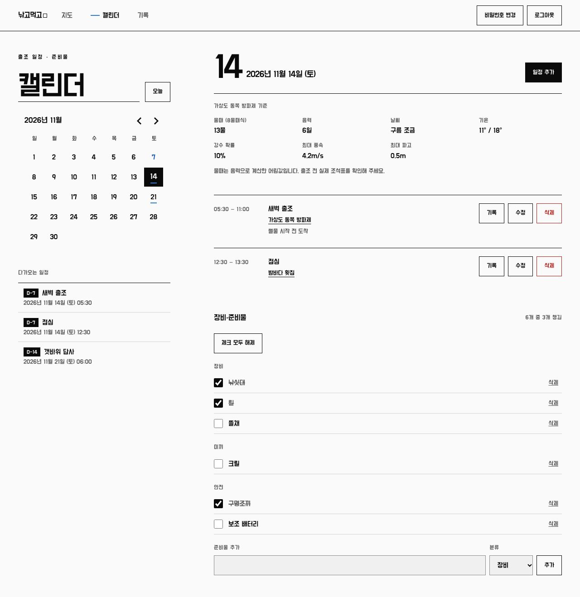
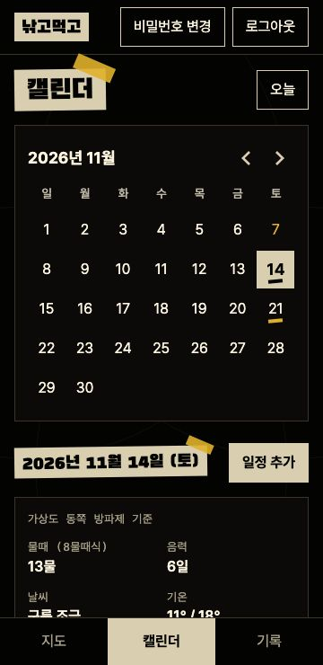
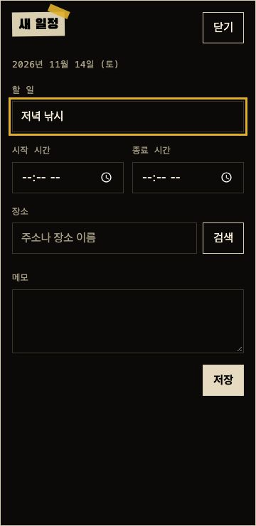

# NGMG Web - 낚고먹고

[](https://github.com/deokbae-cinephile/NGMG-web/actions/workflows/ci.yml)


낚시 포인트와 맛집을 지도에 남기고, 캘린더로 출조 일정과 준비물을 함께 챙기는 2인용 반응형 웹 서비스입니다.

> **프로젝트 상태:** 두 사람이 직접 쓰기 위해 개발 중입니다. 실서버(Supabase)와 Kakao 지도 연결 전이며, 지금은 가짜 서버를 쓰는 데모와 E2E로만 검증했습니다.

## 화면

화면의 장소, 일정, 기록은 모두 가상 데이터입니다. 지도 화면은 Kakao 키를 연결한 뒤 추가합니다.

| 캘린더                                                                                                                 | 로그인                                                                       |
| ---------------------------------------------------------------------------------------------------------------------- | ---------------------------------------------------------------------------- |
|  |  |

| 휴대폰 캘린더                                                                                     | 일정 작성                                                                     | 전체 기록                                                                     |
| ------------------------------------------------------------------------------------------------- | ----------------------------------------------------------------------------- | ----------------------------------------------------------------------------- |
|  |  |  |

## 주요 기능

| 기능     | 내용                                                                       |
| -------- | -------------------------------------------------------------------------- |
| 지도     | 낚시 포인트·맛집 핀, 핀 묶음, 분류 필터, 이름 찾기, 지도를 눌러 위치 지정, 길찾기 |
| 장소     | 주소·이름 검색으로 추가, 위도·경도 직접 입력, 메모, 수정과 삭제                   |
| 캘린더   | 날짜를 눌러 시간대별 일정 작성, 장소 검색·연결, 다가오는 일정과 D-day             |
| 물때·날씨 | 일정 장소 기준 물때와 음력, 15일 예보(날씨, 기온, 강수, 바람, 파고)              |
| 준비물   | 날짜별 장비·준비물 목록, 기본 목록·이전 목록 복사, 체크와 일괄 해제               |
| 기록     | 조과·별점·메모, 사진 10장(자동 압축), 일정에서 바로 작성, 분류 필터, 무한 스크롤 |
| 함께 쓰기 | 등록된 두 계정이 모든 데이터를 함께 보고 수정, 비밀번호 변경, 홈 화면 추가        |

## 기술 스택


| 구분        | 사용 기술                                                              |
| ----------- | ---------------------------------------------------------------------- |
| 프레임워크  | React 19, TypeScript, Vite, React Router                               |
| UI          | Tailwind CSS, 네이티브 dialog, react-day-picker, Pretendard, 검은고딕 |
| 지도·검색   | Kakao Maps JavaScript SDK, Open-Meteo                                  |
| 상태·데이터 | TanStack Query, React Hook Form, date-fns, js-cookie                   |
| 서버        | Supabase (Postgres, RLS, Auth, Storage)                                |
| 품질        | ESLint, Vitest, Testing Library, Playwright, axe, PGlite               |
| 배포        | GitHub Pages, GitHub Actions                                           |

## 시작하기

Node.js 24(`.nvmrc`)와 pnpm이 필요합니다. 서버와 키 없이 가상 데이터로 바로 써 볼 수 있습니다.

```bash
pnpm install
pnpm exec playwright install chromium
pnpm run demo
```

실서버에 연결할 때는 `.env.example`을 `.env`로 복사해 값을 채우고 `pnpm run dev`로 실행합니다.

| 명령                          | 설명                                     |
| ----------------------------- | ---------------------------------------- |
| `pnpm run demo`               | 가짜 서버로 앱 실행 (창을 닫으면 초기화) |
| `pnpm run build`              | 타입 검사와 프로덕션 빌드                |
| `pnpm run lint` / `typecheck` | ESLint / 타입 검사                       |
| `pnpm test`                   | 단위·컴포넌트 테스트                     |
| `pnpm run test:db`            | DB 권한(RLS)과 제약 조건 테스트          |
| `pnpm run test:e2e`           | 프로덕션 빌드 E2E (360·768·1280px, axe) |
| `pnpm run shots`              | README 스크린샷 생성                     |

서버 준비와 배포 방법은 [개발 가이드](docs/development.md)를 참고하세요.

## 프로젝트 구조

```
docs/          문서, 스크린샷
e2e/           Playwright E2E, 가짜 서버, 데모
public/        아이콘, 웹 앱 매니페스트
supabase/      마이그레이션, RLS 테스트
src/
├─ app/        앱 진입, 라우팅, 전역 스타일
├─ pages/      지도, 캘린더, 기록, 장소 상세, 로그인
├─ widgets/    앱 틀, 장소 지도
├─ features/   로그인, 비밀번호 변경, 장소·기록·일정 작성, 날짜별 준비물
├─ entities/   세션, 장소, 기록, 일정, 준비물, 물때·날씨
└─ shared/     Supabase 연결, Kakao SDK, 공통 UI·유틸
```

## 문서

| 문서                               | 내용                                 |
| ---------------------------------- | ------------------------------------ |
| [개발 가이드](docs/development.md) | 서버 준비, 환경 변수, 배포, 디자인 토큰 |
| [CHANGELOG](CHANGELOG.md)          | 버전 기록                            |
